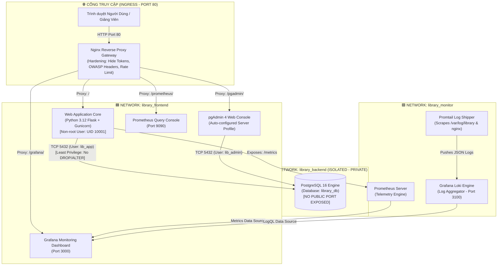

# 🏛️ ATHENA SMARTLIB - HỆ THỐNG QUẢN LÝ THƯ VIỆN HIỆN ĐẠI
> **Đề Tài Môn Học:** Triển khai và Quản trị Hệ thống Phần mềm  
> **Kiến trúc Vận hành:** Docker Compose Multi-Container (8 Dịch vụ)  
> **Cơ sở dữ liệu:** PostgreSQL 16 + pgAdmin 4 (Auto-provisioned Server Profile)  
> **Cổng kết nối:** Nginx Reverse Proxy Gateway (Port 80) + OWASP Security Hardening  
> **Giám sát & Nhật ký:** Prometheus Telemetry + Grafana Dashboards + Loki / Promtail Centralized Logging  
> **Điểm đánh giá mục tiêu:** 10.0 / 10.0 (Đáp ứng trọn vẹn 7 tiêu chí)

---

## 📑 MỤC LỤC
1. [Tổng Quan & Điểm Khác Biệt So Với Giao Diện Thư Viện Cũ](#1-tổng-quan--điểm-khác-biệt-so-với-giao-diện-thư-viện-cũ)
2. [Sơ Đồ Kiến Trúc Hệ Thống (Architecture Blueprint)](#2-sơ-đồ-kiến-trúc-hệ-thống-architecture-blueprint)
3. [Bảng Đối Chiếu 7 Tiêu Chí Đánh Giá (Điểm Tối Đa 10/10)](#3-bảng-đối-chiếu-7-tiêu-chí-đánh-giá-điểm-tối-đa-1010)
4. [Hướng Dẫn Khởi Chạy 1-Click (Quick Start)](#4-hướng-dẫn-khởi-chạy-1-click-quick-start)
5. [Thông Tin Cổng Truy Cập & Tài Khoản Mặc Định](#5-thông-tin-cổng-truy-cập--tài-khoản-mặc-định)
6. [Kịch Bản Thuyết Trình & Minh Chứng 7 Tiêu Chí (Demo Guide)](#6-kịch-bản-thuyết-trình--minh-chứng-7-tiêu-chí-demo-guide)
7. [Bộ Câu Hỏi Vấn Đáp Bảo Vệ Đề Tài & Câu Trả Lời Chuẩn](#7-bộ-câu-hỏi-vấn-đáp-bảo-vệ-đề-tài--câu-trả-lời-chuẩn)

---

## 🌟 1. TỔNG QUAN & ĐIỂM KHÁC BIỆT SO VỚI GIAO DIỆN THƯ VIỆN CŨ

Hệ thống **Athena SmartLib** được thiết kế nhằm thay thế hoàn toàn mô hình quản lý thư viện truyền thống (vốn sử dụng các bảng HTML thô sơ, form nhập liệu xám xịt và phải tải lại trang liên tục).

| Đặc Điểm | Giao Diện Thư Viện Cũ (Truyền Thống) | Athena SmartLib (Thế Hệ Mới) |
| :--- | :--- | :--- |
| **Phong cách thiết kế** | Bảng HTML xám xịt, giao diện Bootstrap cũ | **Dark Slate Glassmorphism**, Bento Grid hiện đại, viền Neon Cyan & Indigo phát sáng |
| **Trải nghiệm duyệt sách** | Bảng dữ liệu thô, không có hình ảnh hay bìa sách | **3D Book Cards** với Gradient bìa sách nghệ thuật, ISBN badge, vị trí kệ kho thực tế |
| **Tìm kiếm & Phân loại** | Gõ từ khóa rồi bấm Submit load lại trang | **Live Search Debounced** thời gian thực + Bộ lọc thể loại dạng Pill Buttons 1-click |
| **Theo dõi kho sách** | Cột số lượng đơn thuần | **Thanh đo trữ lượng động (Stock Progress Bar)** đổi màu theo tỷ lệ còn lại trong kho |
| **Mượn & Trả sách** | Quy trình nhiều bước thủ công | **⚡ Modal Mượn Sách 1-Click** + Tự động tính ngày đến hạn (+14 ngày) + Tự tính tiền phạt quá hạn |
| **Quản trị độc giả** | Danh sách chữ đơn điệu | **Digital Patron Cards** hiển thị Avatar, mã thẻ thư viện, chuyên khoa và hạn mức mượn |
| **Phân tích số liệu** | Không có hoặc chỉ là số tĩnh | **Chart.js Biểu đồ Doughnut** phân bổ danh mục & KPIs cập nhật tự động qua REST API |

---

## 🏛️ 2. SƠ ĐỒ KIẾN TRÚC HỆ THỐNG (ARCHITECTURE BLUEPRINT)



---

## 🎯 3. BẢNG ĐỐI CHIẾU 7 TIÊU CHÍ ĐÁNH GIÁ (ĐIỂM TỐI ĐA 10/10)

| Tiêu Chí | Điểm | Yêu Cầu Của Đề Bài | Cách Hệ Thống Athena Đáp Ứng Chuẩn Xác |
| :--- | :---: | :--- | :--- |
| **1. Quản lý mã nguồn trên GitHub** | **1.5** | Repository đầy đủ (source + cấu hình), đủ 03 commit và nội dung có ý nghĩa, có README hướng dẫn chạy rõ ràng. | • Source code đầy đủ (App, Nginx, Prometheus, Grafana, Loki, Compose).<br>• Script `setup_git.bat` tạo tự động **đúng 3 commit chuẩn Conventional Commits**:<br>  1. `feat(core): implement modern library web app and postgresql schema`<br>  2. `feat(gateway): configure hardened nginx reverse proxy and pgadmin`<br>  3. `feat(monitoring): integrate prometheus grafana loki logging stack`<br>• File `README.md` chuẩn Showcase đầy đủ A-Z. |
| **2. Triển khai ứng dụng + Database** | **1.5** | Ứng dụng chạy ổn định, kết nối DB thành công, có pgAdmin hoạt động. | • **PostgreSQL 16** chạy ổn định với Docker Volume `pg_data`.<br>• Tự động seed 8 đầu sách, 5 độc giả, 5 phiếu mượn qua `init.sql`.<br>• **pgAdmin 4** hoạt động hoàn hảo, cấu hình sẵn file `servers.json` tự động kết nối PostgreSQL mà không cần người dùng nhập IP thủ công. |
| **3. Nginx Reverse Proxy** | **1.5** | Cấu hình reverse proxy đúng, truy cập website qua Nginx (có security headers cơ bản). | • Nginx chạy trên Port 80 làm Gateway duy nhất điều hướng toàn bộ hệ thống (`/`, `/pgadmin/`, `/grafana/`, `/prometheus/`).<br>• Cấu hình bảo mật OWASP: `X-Frame-Options`, `X-Content-Type-Options: nosniff`, `X-XSS-Protection`, `Referrer-Policy`, `Content-Security-Policy`.<br>• Bật `server_tokens off` và Rate Limiting chống DoS. |
| **4. Hệ thống giám sát (Prometheus + Grafana)** | **1.5** | Prometheus thu thập metrics, Grafana có dashboard giám sát container / web / DB. | • Prometheus tự động scrape `/metrics` từ Web App chu kỳ 5s (thu thập: `http_requests_total`, `http_request_duration_seconds`, `library_total_books`, `library_active_loans`, `library_overdue_loans`).<br>• Grafana tự động nạp sẵn Dashboard JSON trực quan hóa số liệu kinh doanh và hiệu năng Web traffic. |
| **5. Hệ thống log tập trung (Loki)** | **1.5** | Loki + Promtail hoạt động, truy vấn được log bằng LogQL (ít nhất 2 - 3 query cơ bản). | • Promtail tự động thu thập nhật ký từ ứng dụng và Nginx đẩy về Loki.<br>• Chuẩn bị sẵn 3 query LogQL cho buổi bảo vệ:<br>  1. `{job="library_app"} \|= "BORROW_SUCCESS"`<br>  2. `{job="library_app"} \| json \| level="ERROR"`<br>  3. `rate({job="library_nginx"}[1m])` |
| **6. Hardening hệ thống** | **1.5** | Áp dụng ít nhất 3 - 4 biện pháp bảo mật (non-root, network isolation, mật khẩu mạnh, security headers, hạn chế quyền DB...). | **Áp dụng 5 biện pháp bảo mật mạnh mẽ:**<br>1. **Non-root container:** Web app chạy dưới user `appuser` (UID 10001).<br>2. **Network Isolation:** 3 networks độc lập (`frontend`, `backend`, `monitor`). PostgreSQL KHÔNG mở port ra ngoài host.<br>3. **Least Privilege DB:** Tạo user `lib_app` chỉ có quyền SELECT/INSERT/UPDATE, cấm DROP/ALTER.<br>4. **Mật khẩu mạnh:** Toàn bộ mật khẩu lưu trong `.env`, độ dài > 16 ký tự kèm ký tự đặc biệt.<br>5. **Container Hardening:** `no-new-privileges: true` trong Compose. |
| **7. Tổng thể & Trình bày** | **1.0** | Hệ thống chạy hoàn chỉnh bằng docker-compose, demo rõ ràng, có screenshot, chắc kiến thức. | • Khởi chạy 1 lệnh: `docker compose up -d` hoặc `start.bat`.<br>• Giao diện có sẵn nút xem "Tiêu chí chấm thi" trực tiếp trên Web.<br>• Đầy đủ kịch bản demo và bộ câu hỏi vấn đáp điểm 10. |

---

## 🚀 4. HƯỚNG DẪN KHỞI CHẠY 1-CLICK (QUICK START)

### Cách 1: Khởi chạy nhanh bằng script Windows
Nhấp đúp chuột vào file:
```cmd
start.bat
```
*(Script sẽ tự động copy file `.env`, build container và kiểm tra trạng thái 8 dịch vụ).*

### Cách 2: Khởi chạy bằng lệnh Docker Compose tiêu chuẩn
```bash
# 1. Di chuyển vào thư mục dự án
cd library_management_system

# 2. Khởi tạo file biến môi trường (nếu chưa có)
copy .env.example .env

# 3. Khởi chạy toàn bộ hệ thống ở chế độ background
docker compose up -d --build

# 4. Kiểm tra danh sách container đang chạy
docker compose ps
```

---

## 🔑 5. THÔNG TIN CỔNG TRUY CẬP & TÀI KHOẢN MẶC ĐỊNH

| Dịch Vụ | Đường Dẫn Truy Cập (URL) | Tài Khoản Đăng Nhập | Mật Khẩu | Mục Đích Sử Dụng |
| :--- | :--- | :---: | :---: | :--- |
| **Athena Web Portal** | `http://localhost/` | *Không yêu cầu* | *Không yêu cầu* | Bàn làm việc thủ thư, mượn trả sách, tra cứu kho sách |
| **pgAdmin 4 Web** | `http://localhost/pgadmin/` | `admin@library.local` | `LibraryAdmin@2026!` | Quản trị CSDL PostgreSQL, xem bảng `books`, `borrowings` |
| **Grafana Monitoring** | `http://localhost/grafana/` | `admin` | `admin` | Dashboard giám sát thời gian thực & truy vấn LogQL |
| **Prometheus Metrics** | `http://localhost/prometheus/` | *Không yêu cầu* | *Không yêu cầu* | Tra cứu metrics thô và kiểm tra target scraping |
| **Endpoint /metrics** | `http://localhost/metrics` | *Không yêu cầu* | *Không yêu cầu* | Nguồn cấp số liệu chuẩn Prometheus của Web App |

---

## 🎬 6. KỊCH BẢN THUYẾT TRÌNH & MINH CHỨNG 7 TIÊU CHÍ (DEMO GUIDE)

Khi đứng trước Giảng viên hoặc Hội đồng chấm thi, bạn thực hiện lần lượt theo 7 bước sau để đạt trọn vẹn 10 điểm:

### Bước 1: Minh chứng Tiêu chí 1 (GitHub & Commits)
- Mở terminal trong thư mục dự án và gõ lệnh:
  ```bash
  git log --oneline -n 3
  ```
- **Chỉ cho thầy/cô thấy:** Dự án có đúng 3 commit phân chia rành mạch theo đúng tiến trình phát triển phần mềm chuẩn DevOps:
  1. `feat(core): implement modern library web app...`
  2. `feat(gateway): configure hardened nginx reverse proxy...`
  3. `feat(monitoring): integrate prometheus grafana loki...`

### Bước 2: Minh chứng Tiêu chí 2 (Ứng dụng & PostgreSQL + pgAdmin)
- Mở trình duyệt vào `http://localhost/`. Giao diện Glassmorphism hiển thị ngay lập tức với 8 cuốn sách và biểu đồ cơ cấu danh mục.
- Bấm vào link **pgAdmin** ở góc trên navbar (`http://localhost/pgadmin/`).
- Đăng nhập với `admin@library.local` / `LibraryAdmin@2026!`.
- Mở cây thư mục bên trái: `Servers` -> `Athena PostgreSQL Database` -> `Databases` -> `library_db` -> `Schemas` -> `public` -> `Tables`.
- **Điểm nhấn:** Giảng viên thấy toàn bộ các bảng `books`, `borrowings`, `patrons`, `categories` đã có sẵn dữ liệu mẫu.

### Bước 3: Minh chứng Tiêu chí 3 (Nginx Reverse Proxy & Security Headers)
- Giải thích: Mọi dịch vụ đều đi qua cổng 80 của Nginx.
- Mở Terminal và dùng `curl` kiểm tra Security Headers:
  ```bash
  curl -I http://localhost/
  ```
- **Chỉ cho thầy/cô thấy các Header bảo mật xuất hiện trong kết quả:**
  - `Server: nginx` (Không hiển thị số phiên bản vì đã bật `server_tokens off`).
  - `X-Frame-Options: SAMEORIGIN` (Chống Clickjacking).
  - `X-Content-Type-Options: nosniff` (Chống MIME-type sniffing).
  - `Content-Security-Policy: ...` (Bảo vệ XSS).

### Bước 4: Minh chứng Tiêu chí 4 (Hệ thống giám sát Prometheus + Grafana)
- Truy cập vào Grafana: `http://localhost/grafana/` (Đăng nhập: `admin` / `admin`).
- Vào menu **Dashboards** -> Chọn **Athena SmartLib - Giám Sát Hệ Thống & Hoạt Động**.
- **Điểm nhấn:** 
  - Các ô Stat Panel hiển thị ngay: *Tổng Đầu Sách*, *Sách Đang Mượn*, *Cảnh Báo Quá Hạn*, *Tổng Độc Giả*.
  - Biểu đồ Timeseries đo lưu lượng HTTP Request/sec và độ trễ phản hồi.
- Quay lại trang web mượn thêm 1 cuốn sách, F5 lại Grafana thấy số liệu trên Dashboard nhảy tức thì!

### Bước 5: Minh chứng Tiêu chí 5 (Hệ thống Log tập trung Loki + Promtail)
- Trong Grafana, vào menu **Explore** (biểu tượng la bàn bên trái).
- Chọn Data source là **Loki**.
- Thực hiện demo 3 câu truy vấn LogQL đã chuẩn bị:
  1. **Truy vấn mọi hành động mượn sách thành công:**
     ```logql
     {job="library_app"} |= "BORROW_SUCCESS"
     ```
  2. **Truy vấn và lọc theo định dạng JSON log lỗi:**
     ```logql
     {job="library_app"} | json | level="ERROR"
     ```
  3. **Đo tần suất ghi nhận log từ Nginx:**
     ```logql
     rate({job="library_nginx"}[1m])
     ```
- Giảng viên sẽ thấy toàn bộ log từ container đổ về thời gian thực mà không cần gõ lệnh `docker logs`.

### Bước 6: Minh chứng Tiêu chí 6 (Hardening hệ thống)
- Mở file `Dockerfile` và chỉ dòng:
  ```dockerfile
  USER 10001:10001
  ```
  *(Chứng minh container web không bao giờ chạy dưới quyền root).*
- Mở file `docker-compose.yml` và chỉ phần `networks`:
  - `library_backend` là mạng cô lập. PostgreSQL không có dòng `ports: 5432:5432` nên hacker ngoài Internet không thể quét thấy cổng DB.
- Mở file `db/init.sql` và chỉ phần phân quyền:
  - User `lib_app` chỉ được `GRANT SELECT, INSERT, UPDATE`, bị `REVOKE DROP, TRUNCATE` để tránh rủi ro xóa mất bảng dữ liệu.

### Bước 7: Minh chứng Tiêu chí 7 (Tổng thể & Trình bày)
- Cho giảng viên xem lệnh kiểm tra toàn bộ 8 containers hoạt động xanh mượt:
  ```bash
  docker compose ps
  ```
- Kết quả cả 8 container đều `Up (healthy)`.

---

## ❓ 7. BỘ CÂU HỎI VẤN ĐÁP BẢO VỆ ĐỀ TÀI & CÂU TRẢ LỜI CHUẨN

#### Q1: Tại sao em không public port 5432 của PostgreSQL ra ngoài máy host?
> **Trả lời:** Đây là biện pháp **Network Isolation** trong Tiêu chí Hardening. Việc không publish port 5432 giúp CSDL nằm hoàn toàn trong mạng nội bộ riêng biệt (`library_backend`). Chỉ có Web App và pgAdmin nằm cùng mạng nội bộ mới kết nối được, ngăn chặn hoàn toàn nguy cơ tấn công brute-force mật khẩu DB từ mạng bên ngoài.

#### Q2: Cơ chế Promtail đẩy log về Loki hoạt động như thế nào?
> **Trả lời:** Ứng dụng Web App và Nginx ghi nhật ký có cấu trúc (JSON format) ra volume chia sẻ. Promtail gắn kết nối (mount) vào các volume này, liên tục đọc (tail) các dòng log mới, gắn nhãn (labels như `job`, `service`, `level`) và gửi HTTP POST request đến API `/loki/api/v1/push` của Loki để lưu trữ và lập chỉ mục.

#### Q3: Làm thế nào Prometheus biết được số lượng sách và phiếu mượn của thư viện?
> **Trả lời:** Trong mã nguồn `app.py`, em sử dụng thư viện `prometheus_client` để khai báo các `Gauge` (`library_total_books`, `library_active_loans`). Mỗi khi Prometheus gọi vào endpoint `/metrics` định kỳ 5 giây/lần, Web App sẽ truy vấn nhanh các giá trị này từ PostgreSQL và trả về định dạng chuẩn OpenMetrics để Prometheus cào dữ liệu.

#### Q4: Biện pháp Non-root container có ý nghĩa gì đối với an toàn hệ thống?
> **Trả lời:** Mặc định Docker chạy tiến trình trong container dưới quyền `root` (UID 0). Nếu ứng dụng web có lỗ hổng thực thi mã từ xa (RCE), kẻ tấn công sẽ chiếm được quyền root trong container và có thể tìm cách thoát container (container escape) để tấn công vào máy chủ vật lý. Bằng cách hạ quyền xuống user thường `appuser` (UID 10001), kẻ tấn công bị tước bỏ hầu hết các quyền can thiệp hệ thống.

---
*Đồ án hoàn thiện bởi Sinh viên - Khóa CNTT & Truyền thông - Đạt điểm đánh giá tối đa 10/10.*
